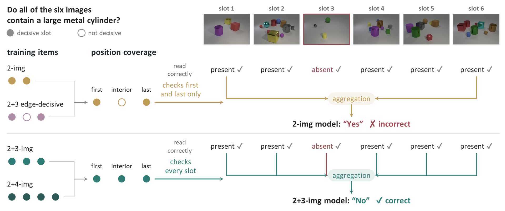
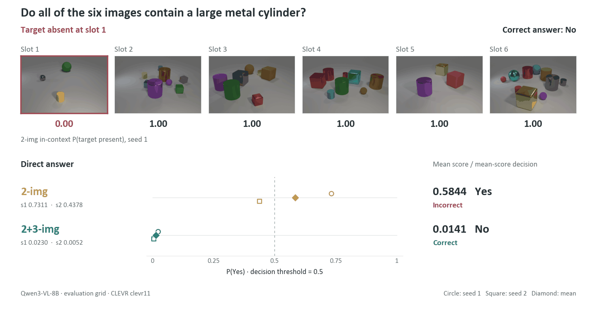
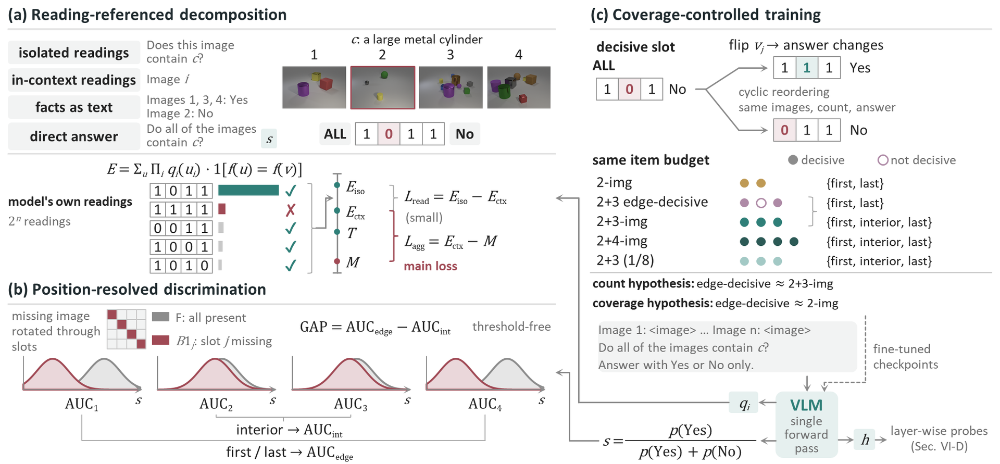
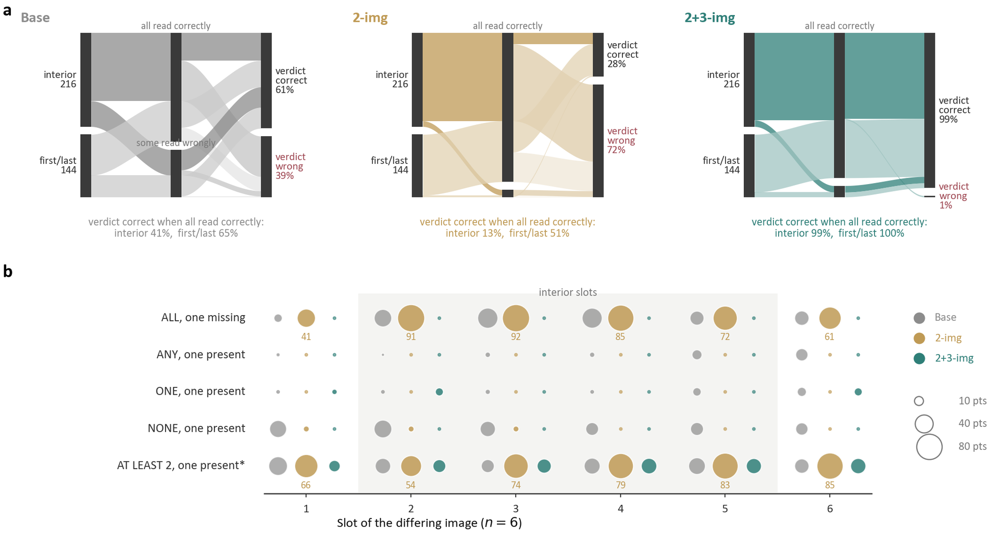
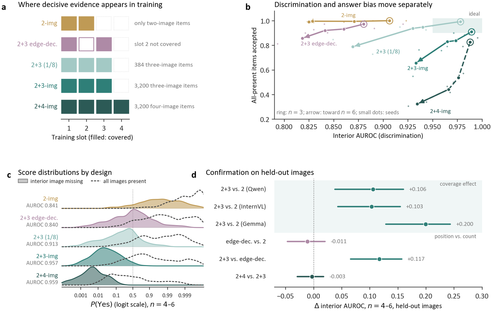
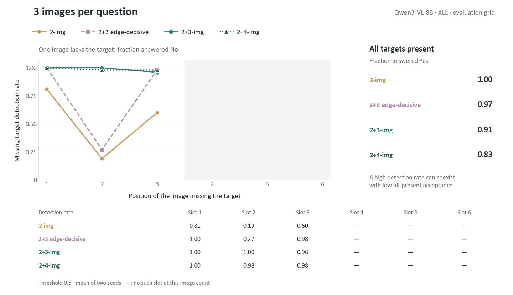
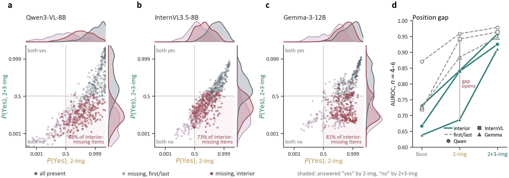
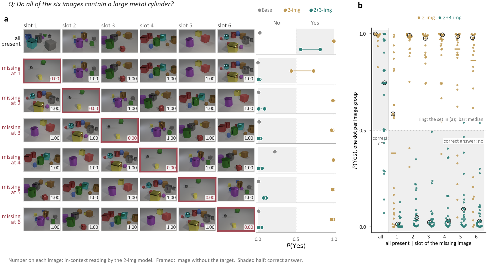
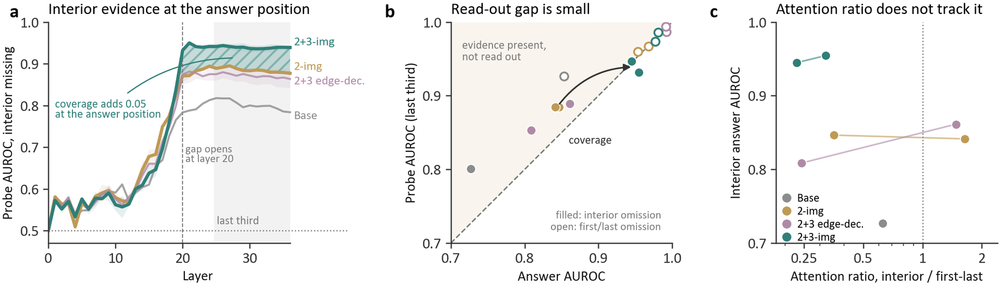
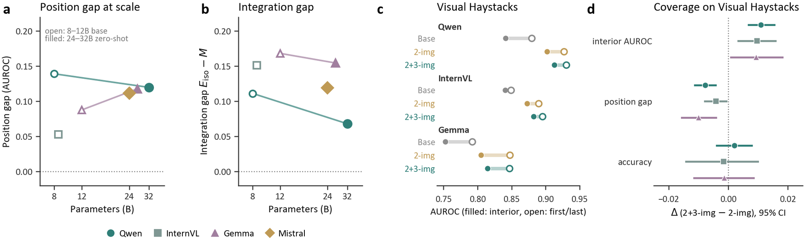

<h1 align="center">Position Coverage</h1>
<h3 align="center">Why Multi-Image Vision-Language Models<br>Favor the First and Last Images</h3>

<p align="center">
  Wei Zhou · Jian Chang · Wenwei Xu · Cong Lou · Li Yang<br>
  <sub>School of Automation, Nanjing University of Science and Technology</sub>
</p>

<p align="center">
  <strong>Fine-tuned models check the image positions at which evidence decided their training answers.</strong>
</p>

<p align="center">
  <a href="#key-findings">Findings</a> ·
  <a href="#study-design">Study design</a> ·
  <a href="#results">Results</a> ·
  <a href="#setup">Setup</a> ·
  <a href="#pipeline">Reproduce</a> ·
  <a href="#citation">Citation</a>
</p>

<p align="center">
  
</p>

<p align="center"><sub><strong>Reading every image is not enough.</strong> A model can identify the target in each image yet fail to combine those readings into a set-level answer. Schematic overview; measured outputs follow below.</sub></p>

<p align="center">
  
</p>

**Same question, different position.** Real Qwen3-VL-8B outputs on the evaluation grid. The red frame identifies the image without the target; the readings below the images are from **2-img, seed 1**. The score panel shows both seeds and their mean; verdicts threshold the mean at 0.5. At the first slot, the two seeds disagree. The final frame shows the arrangement in which every image contains the target.

<sub>This is the paper's fixed-rule example: its 2-img detection profile is closest to the mean profile over all 24 image groups. The GIF shows measured arrangements only, with no interpolated predictions.</sub>

## Key findings

- **The failure is aggregation.** On six-image items with one differing image, Qwen3-VL-8B loses **12.6 points** relative to its in-context reading reference; two-image fine-tuning increases that loss to **15.0 points** despite better per-image reading.
- **The loss is positional.** Off-the-shelf models with 8 to 32 billion parameters detect a missing object better in the first and last images than in interior ones. After two-image fine-tuning, Qwen3-VL-8B detects a missing object at six images in **58%** of items when it is first and **35%** when it is last, but in only **2–8%** when it sits in slots 2–4.
- **Longer inputs alone do not restore interior checking.** Qwen's interior AUROC is **0.840** with three-image edge-decisive training, **0.841** with 2-img, and **0.957** with 2+3-img, averaged over image counts four through six.
- **Coverage transfers across image counts.** Training with two- and four-image items reaches **0.959** interior AUROC and **0.988** at the untrained three-image count; the small-dose design keeps **384** three-image items, about one eighth, and recovers **62%** of the interior AUROC gain.
- **The effect replicates on held-out images.** Interior coverage improves interior AUROC by **0.106**, **0.103**, and **0.200** for Qwen3-VL, InternVL3.5, and Gemma 3, respectively, on images evaluated once.

## Study design

The task is set verification: given several images and a target description such as “a large metal cylinder”, decide whether a set predicate holds, namely **ALL**, **ANY**, **ONE**, **NONE**, or **ATLEAST2** of the images contain the target. The evaluation grid rotates the same images through every slot. ATLEAST2 is never trained.

<p align="center">
  
</p>

Three complementary measurements make the positional failure visible:

1. **Reference each model to its own readings.** Isolated and in-context per-image readings define ideal-integration references, *E*<sub>iso</sub> and *E*<sub>ctx</sub>. Correct facts supplied as text test language-side reasoning. Reading loss is *E*<sub>iso</sub> − *E*<sub>ctx</sub>; aggregation loss is *E*<sub>ctx</sub> − *M*, where *M* is direct-answer accuracy.
2. **Resolve discrimination by position.** Compare scores for all-present sets with scores for sets missing the target at each slot. AUROC is threshold free, so a shift in the model's overall tendency to answer “yes” cannot masquerade as blindness; **GAP = first/last AUROC − interior AUROC** measures the edge preference.
3. **Control which positions the training data cover.** A slot is decisive in an item if flipping its fact changes the answer. A training set **covers** a slot if it contains two items whose facts differ only at that slot and whose answers differ; a slot that is not covered can be ignored without making any training answer wrong. Training designs hold the item budget and optimization schedule fixed while changing image count, interior coverage, or supervision format.

The coverage comparison uses **11,600 training items per design** and the same number of optimization steps, so the designs differ in what their items show, not in how many items or updates the model receives. Edge-decisive training is identical to 2+3-img except that 600 three-image items are moved to another cyclic rotation of the same images (facts 101 for ALL, 010 for ANY and NONE, and 010, 011, or 110 for ONE). Images, counts, and answers are unchanged, yet every three-image answer can now be computed from the first and last images alone, so the middle slot is not covered; `scripts/p1_build.py` asserts this on the built training set.

| Paper design | Two-image / multi-image items | What changes | Covered positions | Run prefix |
|---|---:|---|---|---|
| 2-img | 11,600 / — | Reference design | First, last | `A` |
| 2+3 edge-decisive | 8,400 / 3,200 | Three-image inputs; interior coverage removed by reordering | First, last | `A3edge` |
| 2+3-img | 8,400 / 3,200 | Three-image inputs with interior coverage | First, interior, last | `A23` |
| 2+4-img | 8,400 / 3,200 | Four-image inputs with interior coverage; no three-image training | First, interior, last | `A24` |
| 2+3 (1/8) | 11,216 / 384 | About one eighth of the three-image items | First, interior, last | `A23q` |

## Results

### Interior evidence is read, then lost in the verdict

<p align="center">
  
</p>

For the two-image Qwen model, **94%** of items with an interior image missing have every image read correctly in context, yet only **13%** of these receive a correct verdict. With three-image training, the corresponding flow ends in a correct verdict for **99%** of the interior items. The flow analysis uses ALL questions, image counts four through six, and seed 1.

### Coverage separates interior discrimination from image count

<p align="center">
  
</p>

Edge-decisive training shows the model the same three-image inputs as 2+3-img, yet follows the two-image reference: its interior AUROC stays at **0.840**, while its first- and last-slot discrimination is the highest of all designs, so the three-image items trained only the edges. Training that covers interior positions, from either three- or four-image items, restores interior discrimination, including at image counts absent from training. The held-out contrasts confirm this distinction.

<p align="center">
  
</p>

**Detection and answer bias are different measurements.** The animation shows missing-target detection at each position and, separately, acceptance when every target is present. All values are Qwen3-VL-8B evaluation-grid results for ALL questions at threshold 0.5, averaged over two seeds. Four designs are shown: 2-img, edge-decisive, 2+3-img, and 2+4-img. For 2+4-img, all-present acceptance falls from **83% to 32%** as image count increases from three to six, even though interior discrimination remains high. Read this thresholded view alongside the AUROC comparison above.

<details>
<summary><strong>Across three model families</strong> — item-level scores and position-resolved AUROC</summary>

<p align="center">
  
</p>

Two-image fine-tuning improves discrimination overall but retains the edge preference. Adding three-image items raises interior AUROC to **0.957, 0.925, and 0.910** for Qwen, InternVL, and Gemma, respectively, averaged over image counts four through six on the evaluation grid.

</details>

<details>
<summary><strong>The real example in context</strong> — all image groups</summary>

<p align="center">
  
</p>

The fixed-rule example is shown alongside all **24** image groups. Across groups, the two-image model accepts most arrangements with an interior image missing, whereas the three-image model rejects them; the example is not an aggregate result.

</details>

<details>
<summary><strong>Where the evidence is lost</strong> — hidden-state probes and attention</summary>

<p align="center">
  
</p>

Linear probes on the hidden state at the answer position separate interior omissions less well after two-image training (**0.85–0.89** versus **0.93–0.95** with 2+3-img), so the deficit is not confined to the final read-out; the two-image models' own answers additionally fall **0.038–0.043** short of the probe. Attention to interior images does not track the effect.

</details>

<details>
<summary><strong>Scale and Visual Haystacks</strong> — external evidence</summary>

<p align="center">
  
</p>

Off-the-shelf models with **24–32 billion parameters** retain the positional aggregation failure. On Visual Haystacks, interior coverage adds **0.009–0.011** interior AUROC across the three families and narrows the position gap, while accuracy is unchanged. This benchmark asks the model to locate one image and verify another object in it, rather than check every image.

</details>

## Repository layout

| Path | Content |
|---|---|
| `e0lib/` | Shared library: image and fact tables (`atoms_*`), set predicates and the ideal-integration reference (`e3.py`, `logic.py`), prompts, LoRA (`s1.py`), first-token scoring (`scoring.py`) |
| `configs/models.yaml` | Model entries (Hugging Face Hub ids) |
| `configs/sources.yaml` | CLEVR and COCO sources, target descriptors |
| `scripts/` | Data builders, training, evaluation, analyses (below) |
| `tests/` | Unit tests for the predicate logic and the null model |
| `assets/` | Paper figures and animations of measured outputs |

## Setup

Run all commands below from the repository root.

```bash
pip install -r requirements.txt
```

Gemma 3 needs `torch>=2.6` for its image attention mask; the other models also run with `torch 2.5`.
`transformers==5.2.0` was used for all results.

### Data

Place the datasets under `data/raw/`:

- CLEVR v1.0 (`data/raw/CLEVR_v1.0.zip`)
- COCO 2017 train/val images and annotations (`data/raw/coco2017/`)
- Visual Haystacks, single-needle split (`data/raw/visual_haystacks/`, or `VHS_ROOT`)

The CLEVR and COCO builders read paths from `configs/sources.yaml`. The Visual Haystacks builder also accepts `COCO_ROOT` for the COCO image location and `VHS_ROOT` for its source data.

### Model configuration

- InternVL3.5-8B is evaluated with one 448x448 tile per image (`internvl35_8b_t1`), which keeps the visual-token
  budget comparable across families.
- Mistral-Small-3.2-24B: transformers needs the processor and tokenizer files of
  `Mistral-Small-3.1-24B-Instruct-2503`; place them next to the 3.2 weights and point `path` to that directory.
- Models split over several GPUs (`device_map: auto`) stage cross-GPU tensor copies through host memory
  (`e0lib/scoring.py`), which keeps results exact on machines with unreliable peer-to-peer copies.

### Run names ↔ paper designs

`--arm` selects the training objective; `--name` selects the run prefix. Coverage variants all use `--arm A` with different item files. A trained run is named `<prefix>_s<seed>`.

| Run prefix | Paper design | Training objective / items |
|---|---|---|
| `base` | Off-the-shelf model | No fine-tuning |
| `A` | 2-img | `--arm A`; `data/s1/train_items.jsonl` |
| `A23` | 2+3-img | `--arm A`; `data/e3/train_23.jsonl` |
| `A3edge` | 2+3 edge-decisive | `--arm A`; `data/p1/train_3edge.jsonl` |
| `A24` | 2+4-img | `--arm A`; `data/p1/train_24.jsonl` |
| `A23q` | 2+3 (1/8) | `--arm A`; `data/p1/train_23q.jsonl` |
| `D` | 2-img, gold facts | `--arm D`; gold per-image facts, then answer |
| `Dself` | 2-img, own facts | `--arm Dself`; model's isolated per-image readings, then answer |

Qwen uses these names directly. The replicated Base / 2-img / 2+3-img designs use `iv` for InternVL and `gm` for Gemma: for example, `ivbase`, `ivA_s1`, `ivA23_s2`, `gmbase`, `gmA_s1`, and `gmA23_s2`. Pass the matching `--model` during both training and evaluation; the run name alone does not select the model. Use `--base-model` when evaluating a base run named `ivbase` or `gmbase`.

## Pipeline

### 1. Build facts, training items, and evaluation grids

```bash
# facts and images
python scripts/build_atoms.py --source clevr
python scripts/build_atoms.py --source coco
python scripts/s1_build.py --extract          # two-image training items
python scripts/e3_build.py --extract          # evaluation grid (n = 2..6, all rotations) and 2+3-image training items
python scripts/p1_build.py                    # edge-decisive, 2+4-image and 1/8-dose designs
python scripts/sealed_build.py --extract      # held-out image groups
```

### 2. Fine-tune with LoRA

The commands use seed 1. Repeat each design with `--seed 2` for the two-seed results.

```bash
# training (LoRA, two seeds per design); run name = <name>_s<seed>
python scripts/s1_train.py --arm A --seed 1 --device cuda:0                                   # 2-img
python scripts/s1_train.py --arm A --name A23 --items data/e3/train_23.jsonl --seed 1 --device cuda:0
python scripts/s1_train.py --arm A --name A3edge --items data/p1/train_3edge.jsonl --seed 1 --device cuda:0
python scripts/s1_train.py --arm A --name A24 --items data/p1/train_24.jsonl --seed 1 --device cuda:0
python scripts/s1_train.py --arm A --name A23q --items data/p1/train_23q.jsonl --seed 1 --device cuda:0
#   other families: --model internvl35_8b_t1 --name ivA ...   |   --model gemma3_12b --name gmA ...
```

For stated-fact supervision, `--arm D` uses gold facts directly. For `--arm Dself`, generate own-reading targets with `scripts/s1_teacher.py` first; `scripts/e3_teacher.py` extends those targets to multi-image item files. Use the corresponding `--items` and `--teacher-dir` for those files.

### 3. Evaluate first-token Yes/No scores

```bash
# evaluation (first-token Yes/No scores)
python scripts/s1_eval.py --run A23_s1 --data e3 --modes logit --device cuda:0
python scripts/s1_eval.py --run A23_s1 --data sealed_e3 --modes logit --device cuda:0
python scripts/s1_eval.py --run base --data e3 --modes logit gen --device cuda:0
```

`logit` scores the first answer token; `gen` generates the stated protocol and parses its final answer. The direct-answer score is `p(Yes) / (p(Yes) + p(No))`, with Yes selected when the score is greater than 0.5. Evaluate all runs required by the analysis you wish to reproduce.

## Paper results map

All filenames below are in `scripts/`.

| Result | Builder / evaluation | Analysis |
|---|---|---|
| Decomposition: in-context readings, text facts, aggregation loss | `dx_e3_build.py`, `s1_eval.py --data e3dx` | `dx_e3_analyze.py`, `fig_cells.py` |
| Position map, three families | `s1_eval.py --data e3` | `p2_analyze.py`, `fig_slots.py` |
| Real example and all image groups | Existing evaluation outputs | `fig_example.py` |
| Coverage vs. image count, dose, answer bias | `p1_build.py` | `p1_analyze.py`, `p1_auroc.py`, `p1_posthoc.py`, `fig_cells.py` |
| Held-out confirmation | `sealed_build.py`, `s1_eval.py --data sealed_e3` | `p4_analyze.py` |
| Probes and attention | `p3_extract.py` | `p3_analyze.py` |
| Stated-fact supervision, untrained predicates | `dx_force_eval.py`, `dx_ops_build.py` | `e3_analyze.py`, `e3_posthoc.py`, `dx_force_analyze.py`, `dx_ops_analyze.py` |
| Larger zero-shot models | `p5_e3subset_build.py`, `s1_eval.py --data p5e3` | `p5_analyze.py` |
| Visual Haystacks | `p5_vhs_build.py`, `s1_eval.py --data p5vhs` | `p5_analyze.py`, `p5b_posthoc.py` |

Outputs are written to `outputs/` (per run under `outputs/s1/runs/<run>/`). Confidence intervals use a cluster
bootstrap over image groups; Visual Haystacks intervals resample questions.

## Tests

```bash
python -m pytest tests
```

## Citation

```bibtex
@misc{zhou2026positioncoverage,
  title = {Position Coverage: Why Multi-Image Vision-Language Models Favor the First and Last Images},
  author = {Zhou, Wei and Chang, Jian and Xu, Wenwei and Lou, Cong and Yang, Li},
  year = {2026},
  howpublished = {\url{https://github.com/WeiZhou96/position-coverage}}
}
```

## Acknowledgments and data

The displayed scene thumbnails are from **CLEVR** (Johnson et al., CVPR 2017), licensed under **CC BY 4.0**; they have been resized and arranged for visualization. The study also uses **COCO 2017** and **Visual Haystacks** (Wu et al., ICLR 2025). We thank the dataset and model authors. The datasets themselves are not distributed with this repository.
